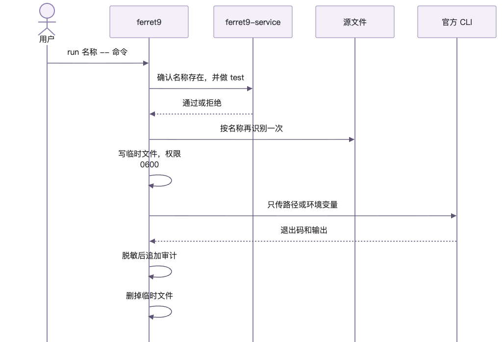

# Ferret9

macOS 本机凭据库。菜单栏 App、命令行和 launchd 拉起的服务共用一个 Unix socket。清单里没有密钥。要执行命令时用 `ferret9 run`，临时文件由它自己建、自己删，密钥不进命令参数。

```bash
ferret9 list
ferret9 run <名称> -- kubectl get ns
ferret9 run <名称> -- aws sts get-caller-identity
```

写操作加 `--reviewed`。不加也执行，审计里记为未审核。

## 组件


| 组件 | 位置 | 谁拿着它 |
|------|------|----------|
| App | `/Applications/Ferret9.app` | 当前登录用户 |
| 命令行 | `/usr/local/bin/ferret9` | 当前登录用户 |
| 服务 | `/Library/PrivilegedHelperTools/ferret9-service` | `_ferret9`，由 `com.ferret9.service` 拉起 |
| 记录 | `/var/db/ferret9/<名称>.json` | `_ferret9`，目录模式 0700 |
| socket | `/var/run/ferret9.sock` | launchd 以 root 创建后交给服务 |
| 审计 | `~/.ferret9/audit/<当天>.jsonl` | 当前登录用户，文件 0600 |

`/usr/local/bin/coffer` 是指向 `ferret9` 的兼容链接。

服务读不了登录用户的家目录，所以代发不在服务里。`run` 先问服务这个名称在不在、`test` 过不过，再由命令行自己读源文件。

## 一次 run 怎么走



| 类型 | `--` 后面的命令 | 凭据怎么交出去 |
|------|----------------|--------------|
| kubeconfig | `kubectl` | `--kubeconfig <临时文件>` |
| aliyun | `aliyun` | `--config-path <临时文件>` |
| aws | `aws` | `AWS_SHARED_CREDENTIALS_FILE` |
| cloudflare | `curl` | curl `--config` 里的请求头 |
| feishu | `curl` | 先换票，票再进 curl `--config` |
| private-key | `ssh` 或 `ssh-keygen` | `-i` 或 `-f` 指向临时文件 |
| token | `gh` | `GH_TOKEN` |
| ossutil、redis | 没有代发 | `run` 直接拒绝 |

命令第一个词必须跟类型对得上。子进程会清掉 `KUBECONFIG`、云厂商 AccessKey 和 `GH_TOKEN`，再只放进这一次要用的那个。输出里如果含库中的密文，整段换成「输出已拦截」。

每次 `run` 往当天的审计文件追加一行：时间、会话、凭据名、类型、命令、是否带 `--reviewed`、退出码、输出。会话取 `FERRET9_SESSION`，没有就取 `CURSOR_CONVERSATION_ID`。写入前把家目录改成 `~`，把 `LTAI`、`AKIA`、`ghp_`、`sk-` 和 PEM 换成 `[已脱敏]`，超过 2000 字截断。审计只留在本机。

各类常用命令在 `skills/ferret9/references/manual-<类型>.md`。索引在 `skills/ferret9/references/invocation.md`。

## 记录和识别

`list`、`inspect`、`paste`、`test` 不弹授权。`add`、`rename`、`replace`、`delete` 先弹系统授权，再写一张 5 分钟的票到 `/var/db/ferret9/grants/`，服务只认这张票。

socket 写在 `packaging/com.ferret9.service.plist` 的 `Sockets` 里，由 launchd 以 root 创建。`_ferret9` 不能自己在 `/var/run` 里 `bind`。

`ferret9 list` 只出名称、类型、说明、指纹。指纹是密钥材料 SHA-256 的前 8 字节，不能反推密钥。第一行是条数，不是一条凭据。

`delete` 只删 `/var/db/ferret9/<名称>.json`，不动 `~/.kube`、`~/.aliyun`、`~/.aws`、`~/.ssh` 里的源文件。

识别器按顺序跑：kubeconfig、阿里云 JSON、INI（AWS、ossutil）、环境变量赋值、扁平 JSON、Cloudflare YAML、飞书、Redis YAML、PEM 私钥、`ghp_` / `sk-` 前缀。PEM 按整份保留，不按空行拆开。没识别出来也会回报编码、分段数和试过的识别器。

`test` 只探测。kubeconfig 读集群名，阿里云发一次 `DescribeRegions`。其余类型回答「已保存」。

## 在 App 里导入


顶栏只有「导入」。没双击就不入库。粘贴框里填的说明不会入库，入库后在右侧改说明再保存。说明写产品、环境、只读还是可写，不要写密钥。换密钥本体用 `ferret9 replace`。

## 命令行

```bash
ferret9 list
ferret9 inspect <文件>
ferret9 inspect - [标签]
ferret9 paste [标签]
ferret9 add <名称> <文件>
ferret9 add-paste <名称> <标签>
ferret9 rename <名称> <说明>
ferret9 replace <名称> <文件>
ferret9 delete <名称>
ferret9 test <名称>
ferret9 run <名称> -- <命令> [参数...]
ferret9 run --reviewed <名称> -- <命令> [参数...]
```

`add`、`rename`、`replace`、`delete` 弹授权。其余不弹。

## Skill 和守卫

`skills/ferret9/` 教 agent 先跑 `ferret9 list`，按说明列选凭据，再走 `ferret9 run`。凭据名单不写进 skill。要执行时先读 `references/invocation.md`，再只读对应的 `references/manual-<类型>.md`。

```bash
npx skills add pengzuhao/ferret9 --skill ferret9
```

装完要新开一轮会话。

守卫拒绝两类：把家目录凭据文件读进对话；直接跑 `kubectl`、`aliyun`、`aws`、`gh`、`ssh`。`ferret9` 和 `coffer` 开头的命令放行。

```bash
bash scripts/install-guard.sh
```

它给本机已装的 agent 写拦截，并把 skill 拷到该 agent 的 `skills/ferret9`，另外一份在 `~/.agents/skills/ferret9`。细节见 [docs/block-direct-credential-reads.md](docs/block-direct-credential-reads.md)。

## 构建

```bash
bash scripts/build.sh build/bin
build/bin/ferret9-tests
sudo cp build/bin/ferret9-cli /usr/local/bin/ferret9
```

命令行编译产物叫 `ferret9-cli`。macOS 默认磁盘不区分大小写，不能在同一目录里再产出名叫 `ferret9` 的 App。

```bash
bash scripts/package.sh
```

产物是 `/tmp/Ferret9-0.0.1.pkg` 和 `/tmp/Ferret9.app`，不要把 `.app` 留在仓库里。正式发布用 Actions 里的 Release，在 `macos-14` 上跑同一套打包。版本号在 `Sources/CofferCore/Protocol.swift` 的 `CofferPaths.version`。

## 仓库

[github.com/pengzuhao/ferret9](https://github.com/pengzuhao/ferret9)
