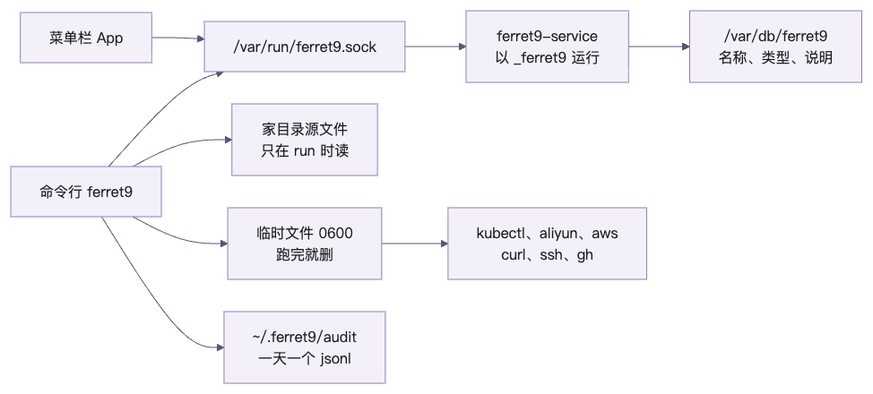
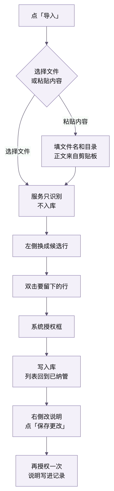

# Ferret9

macOS 本机凭据库。一个菜单栏 App、一个命令行、一个由 launchd 拉起的服务，三者共用同一个 Unix socket。识别、存储、探测都在本机完成，密钥不交给模型。

它不是密钥代发器。库里记下的是「这台机器上有哪些凭据、各自是什么」，真正发请求仍然用官方 CLI。

## 组件



| 组件 | 位置 | 谁拿着它 |
|------|------|----------|
| App | `/Applications/Ferret9.app` | 当前登录用户 |
| 命令行 | `/usr/local/bin/ferret9` | 当前登录用户 |
| 服务 | `/Library/PrivilegedHelperTools/ferret9-service` | 系统用户 `_ferret9`，由 `com.ferret9.service` 拉起 |
| 数据 | `/var/db/ferret9/<名称>.json` | `_ferret9`，目录模式 0700 |
| socket | `/var/run/ferret9.sock` | launchd 以 root 创建后把监听描述符交给服务 |

`/usr/local/bin/coffer` 是指向 `ferret9` 的兼容链接，旧命令仍然能用。

## 一次请求怎么走

App 和命令行走同一条路，区别只在谁去弹授权框。


读操作（`list`、`inspect`、`paste`、`test`）不弹授权框，也不查票。

## 关键机制

### socket 不是服务自己建的

`_ferret9` 是普通用户，没有权限在 `/var/run` 里 `bind`。所以 socket 写在 `packaging/com.ferret9.service.plist` 的 `Sockets` 里，由 launchd 以 root 创建，再用 `launch_activate_socket("Listener")` 把监听描述符交给服务。这个函数成功时返回 0（见 `launch(3)`）。只有拿不到这个描述符时（比如手动跑服务而不是 launchd 拉起），才退回到自己 `bind` 命令行给定的路径。

### 写入要两次授权

`add`、`rename`、`replace`、`delete` 先调 `AuthorizationCreate`，权限名是 `com.ferret9.manage`，弹出系统授权框。用户点允许后，客户端再弹一次管理员密码，把一个 32 位十六进制票写进 `/var/db/ferret9/grants/`，文件内容是过期时间戳，有效期 5 分钟，并 `chown` 给 `_ferret9`。服务收到请求后只认这张票：名称合法、文件存在、没过期。

这是两次弹框，不是一次。第一次确认意愿，第二次才有权限把票写到受保护的数据目录。

### 记录里有什么，清单里没有什么

每条记录是一个 JSON，里面有名称、类型、说明、指纹、入库时间、完整 payload 和从 payload 里抽出来的密文串。

`ferret9 list` 和 App 列表只拿前面几项：名称、类型、说明、指纹。指纹是密钥材料的 SHA-256 前 8 字节，用来辨认是不是同一把，不能反推密钥。密文串只在服务内部用：`test` 的输出里如果出现任一条长度不少于 6 的密文，整段输出被替换成「输出已拦截」。

### 删除只删记录

`delete` 删的是 `/var/db/ferret9/<名称>.json`。它不动详情里「路径」指向的那个源文件，`~/.kube`、`~/.aliyun`、`~/.ssh` 里的文件都不会被碰。App 里对应的按钮是「从列表中移除…」。

记录本身不保存源文件路径。App 详情里的路径来自一份写在客户端的名称对照表（`Catalog`），对不上就显示「未记录原始路径」。仓库里这份表只有 `example-*` 示例，真正使用时换成自己的名称。

### 识别

`inspect`、导入、`add` 走同一条管线：先按多种编码解码，再按空行或 `---` 分段，每段依次跑这些 detector：

kubeconfig、阿里云 JSON、INI（AWS、ossutil）、环境变量赋值、扁平 JSON、Cloudflare YAML、飞书、华为 OBS、Redis YAML、PEM 私钥、以及 `ghp_` / `sk-` 前缀的启发式 token。

一个都没识别出来也会返回编码、分段数和已尝试的 detector 名称，而不是一个空错误。同一段里多个 detector 命中时按名称去重。

### 测试

`test` 按类型分流。kubeconfig 会把文档写到临时文件，跑 `kubectl config view --minify` 读出集群名，随后删掉临时文件。阿里云会对 ECS 发一次只读的 `DescribeRegions`。其余类型（AWS、ossutil、Cloudflare、飞书、OBS、Redis、私钥、token）只回答「已保存」，不代发请求。

## 在 App 里导入和维护

打开菜单栏上的 Ferret9，选「打开」。窗口左侧是已纳管列表（名称、类型、说明），右侧是选中那一条的详情。顶栏只有一个按钮：「导入」。



没双击就还停在候选列表。点菜单栏 Ferret9 →「打开」会丢弃候选，回到已入库的列表，不会写入任何东西。

粘贴对话框里的「说明」和「类型」填了也不会入库，代码接下来没再读它们。入库时的说明是识别器生成的占位，比如一个 context 名或一个 region。要让模型用对，必须在入库之后于右侧改掉再保存。

选中已入库的一条，右侧可以做的事：

| 控件 | 作用 |
|------|------|
| CLI | 只读。按类型显示对应的命令名，例如 `kubectl cli`、`aliyun cli` |
| 说明 + 保存更改 | 唯一可编辑的字段。保存弹授权，写进这条记录的说明。这是模型选凭据的依据 |
| 路径 + 显示 | 只读。路径来自客户端写死的名称对照表，对不上显示「未记录原始路径」。「显示」在 Finder 里定位，不打开文件 |
| 命令 + 测试 | 命令只读，是给人看的用法提示。「测试」走 `test`，不弹授权 |
| 从列表中移除… | 弹授权后删掉库里这条记录，不动路径指向的源文件 |

窗口里没有换内容的按钮。要替换已入库的密钥本体，用命令行 `ferret9 replace`。

说明写什么：产品、环境、只读还是可写、profile、context 或 region。名称保持稳定，语义放在说明里。差的是一个单词，好的是「示例云账号，cn-hangzhou，只读」。不要把密钥写进说明。

## 命令行

```bash
ferret9 list                          # 名称、类型、说明、指纹
ferret9 inspect <文件>               # 只识别，不入库
ferret9 inspect - [标签]             # 从 stdin 读
ferret9 paste [标签]                 # 同 inspect -
ferret9 add <名称> <文件>           # 入库，弹授权
ferret9 add-paste <名称> <标签>     # 从 stdin 入库，弹授权
ferret9 rename <名称> <说明>        # 只改说明，弹授权
ferret9 replace <名称> <文件>       # 换内容，弹授权
ferret9 delete <名称>               # 删记录，不动源文件，弹授权
ferret9 test <名称>                 # 按类型探测，不弹授权
```

`list` 的第一行是条数说明，不是一条凭据。其后每行用制表符分开。

## Skill

`skills/ferret9/` 是一份 [Agent Skills](https://agentskills.io/specification) 包，目录名和 frontmatter 的 `name` 都是 `ferret9`。它教 agent 怎么查凭据、怎么报回、哪些事不该做。

模型选哪一条，主要看 `ferret9 list` 里的「说明」列，不看名称。用户说的环境、产品、集群、只读还是可写，要能在某一行的说明里找到对应的词。类型只用来排除种类明显不对的行。名称是稳定标识，不拿来猜用途。说明为空，或还是导入时识别器留下的占位，就当这条还没写好：skill 要求模型直说对不上，请人回 App 里改说明，而不是用名称硬凑。

**它不随数据自动更新。** 增、删、改、查都只动 `/var/db/ferret9` 里的记录，没有任何代码去改 `skills/ferret9/` 下的文件。凭据清单不写进 skill：抄进去会过期，也会把账号名单留在每个 agent 的上下文里。联动指的是 agent 每次用凭据前都现跑一次 `ferret9 list`，拿到的是库里当时的内容。

安装（`skills/` 是这两个安装器的默认扫描路径）：

```bash
hermes skills install pengzuhao/ferret9/skills/ferret9

npx skills add pengzuhao/ferret9 --skill ferret9
```

订阅整个仓库再装：

```bash
hermes skills tap add pengzuhao/ferret9
hermes skills install pengzuhao/ferret9/skills/ferret9
```

Hermes 安装时会带上 `SKILL.md` 引用的 `references/`。装完要新开一轮会话，已经打开的会话不会重新加载 skill。

## 日常怎么用

**不用开着 App。** 查目录和探测走的是 launchd 拉起的 `com.ferret9.service`，窗口开不开都不影响。服务随开机启动，`KeepAlive` 会在它退出后重新拉起。

| 要做的事 | 用什么 | App 要开着吗 |
|----------|--------|--------------|
| 看有哪些凭据 | `ferret9 list` | 不用 |
| 确认一条还能用 | `ferret9 test <名称>` | 不用 |
| 导入、改说明、换内容、从列表移除 | 命令行，或 App 里的按钮 | 不用先打开。命令行自己弹系统授权框 |
| 真正发请求 | `kubectl`、`aliyun`、`ossutil` 这些官方 CLI | 不用 |

**原来直接用官方 CLI 和本机配置文件的方式仍然可行。** Ferret9 不是代理，不拦截这些命令。它只记录这台机器上有哪些凭据。`delete` 和「从列表中移除…」只删 `/var/db/ferret9/<名称>.json`，不动 `~/.kube`、`~/.aliyun`、`~/.ssh` 里的源文件。`/usr/local/bin/coffer` 仍是指向 `ferret9` 的链接，旧命令打到同一个服务。

变的是 agent 的选凭据方式。新开会话并加载 `skills/ferret9` 之后，查集群、云、DNS、OSS 时会先跑 `ferret9 list`，按说明列挑选，不再自己去翻家目录里的密钥文件。你点名某个配置文件并明确要求直接用它，这条限制不适用。

要堵住「绕过 Ferret9、把密钥文件读进对话」，不用克隆仓库，跑一条命令：

```bash
curl -fsSL https://raw.githubusercontent.com/pengzuhao/ferret9/main/scripts/install-guard.sh | bash
```

它只给本机装了的 agent 写拦截，写完用样本验证，收尾一行写明装了几个、跳过几个、失败几个。细节和「交给模型去装」的提示词见 [docs/block-direct-credential-reads.md](docs/block-direct-credential-reads.md)。拦的是读进对话，不是官方命令自己读文件。

## 构建

```bash
bash scripts/build.sh build/bin
build/bin/ferret9-tests
```

构建产出三个二进制：`ferret9-service`、`ferret9-cli`、`Ferret9`。命令行工具不叫 `ferret9`，因为 macOS 默认磁盘不区分大小写，后面编出的 App 会把它覆盖掉。打包时再改回 `ferret9` 这个名字。

```bash
bash scripts/package.sh
```

产物是 `/tmp/Ferret9-0.0.1.pkg` 和 `/tmp/Ferret9.app`，不要把 `.app` 留在仓库里。安装包会建 `_ferret9` 用户、复制数据目录、卸掉旧的 `com.coffer.service`。`/var/db` 受 SIP 保护，数据是复制而不是移动，旧目录仍在。

正式发布不在本机打包。仓库的 Actions 里有「Release」，手动触发，在 `macos-14` 上跑同一套 `scripts/package.sh`，把 pkg、zip 打包的 App 和 sha256 挂到对应 tag 的 Release 上。版本号取自 `Sources/CofferCore/Protocol.swift` 里的 `CofferPaths.version`。

## 仓库

[github.com/pengzuhao/ferret9](https://github.com/pengzuhao/ferret9)
